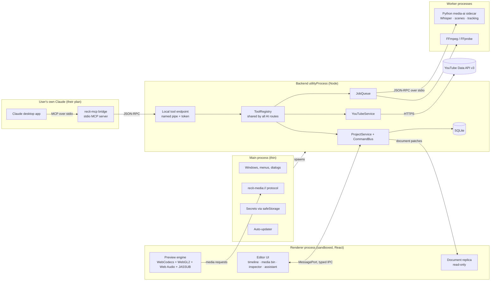
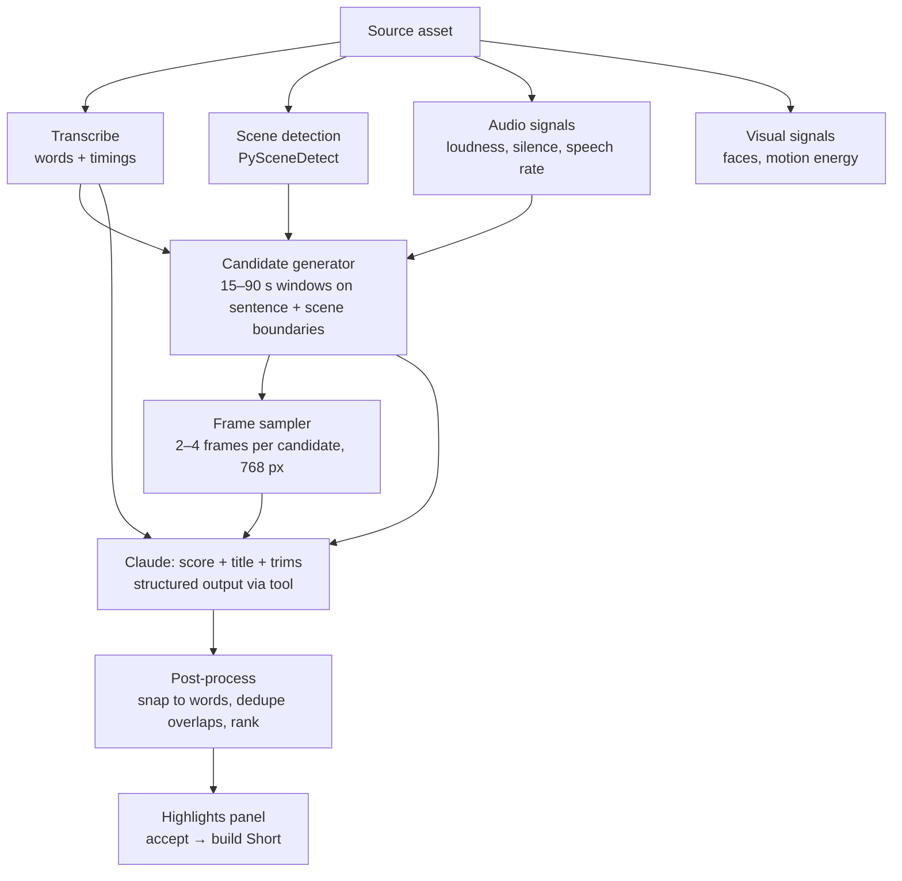

# Rec-It Architecture

Version 0.2 · November 2026 · Changes from 0.1: open source (GPL), Windows + NVIDIA first, Claude connected through MCP and the user's own Claude plan instead of a paid API key, editor-first priority.

This document describes how Rec-It is built: the process model, how the parts communicate, the data models, the rendering pipeline, how Claude drives the editor, and the risks and costs. The reasoning behind each major choice is recorded in [DECISIONS.md](DECISIONS.md) as ADR-nnn.

---

## Contents

1. [Design principles](#1-design-principles)
2. [System overview](#2-system-overview)
3. [Process model](#3-process-model)
4. [Project folder structure](#4-project-folder-structure)
5. [How the technologies communicate](#5-how-the-technologies-communicate)
6. [Data models](#6-data-models)
7. [Editing engine: commands, undo and state](#7-editing-engine-commands-undo-and-state)
8. [Media pipeline: import, probe, proxies](#8-media-pipeline-import-probe-proxies)
9. [Preview engine](#9-preview-engine)
10. [FFmpeg rendering and export](#10-ffmpeg-rendering-and-export)
11. [Transcription and captions](#11-transcription-and-captions)
12. [Vertical 9:16 reframing](#12-vertical-916-reframing)
13. [Claude integration and tool calling](#13-claude-integration-and-tool-calling)
14. [AI analysis and clip selection](#14-ai-analysis-and-clip-selection)
15. [YouTube research and rights-aware importing](#15-youtube-research-and-rights-aware-importing)
16. [Batch Shorts creation](#16-batch-shorts-creation)
17. [Storage](#17-storage)
18. [UI architecture and design system](#18-ui-architecture-and-design-system)
19. [APIs, dependencies and services](#19-apis-dependencies-and-services)
20. [Technical limitations](#20-technical-limitations)
21. [Security risks and mitigations](#21-security-risks-and-mitigations)
22. [Costs](#22-costs)
23. [Testing strategy](#23-testing-strategy)

---

## 1. Design principles

1. **One source of truth for the project.** The project document lives in the backend process. The UI and Claude both change it only by issuing *commands*. Neither writes to it directly.
2. **Claude is a user of the editor, not a part of it.** Claude can do only what the tools allow. Every tool is validated with a schema, can be undone and is logged. Claude never gets shell, filesystem or network access.
3. **What you preview is what you export.** Preview and export are both built from one intermediate *RenderPlan*. Captions are drawn by the same engine (libass) on both sides. Golden-frame tests check that the two match.
4. **Heavy work never runs on the UI thread.** Decoding, encoding, transcription and analysis run in separate processes, as jobs that can be cancelled and report progress.
5. **Local first.** Media, projects and transcripts stay on the user's machine. Only what Claude asks for through a tool (text, downscaled frames, metadata) leaves the machine, and the user is told this.
8. **The editor stands on its own.** Every feature in Phases 0–5 works with no AI connection. Claude is an optional operator of the editor, never a dependency of it.
9. **Free to use.** No hosted services, no accounts, no paid APIs required. AI usage comes from the user's own Claude plan.
6. **Modular packages with clear boundaries.** The domain logic (`packages/core`) is plain TypeScript with no Electron, React or Node-specific dependencies, so it can be unit-tested in isolation.
7. **Honest AI.** The assistant reports confidence and reasons. It does not claim to predict virality.

---

## 2. System overview



The optional in-app assistant panel (Section 13.1, Route C) calls the same ToolRegistry through the Claude Agent SDK; it is not shown above.

---

## 3. Process model

Electron has a main process and renderer processes. Rec-It adds one backend `utilityProcess` and short-lived worker processes.

| Process | Responsibilities | Why it is separate |
|---------|------------------|--------------------|
| **Main** | App lifecycle, windows, native menus, file dialogs, the `recit-media://` protocol, `safeStorage` secrets, auto-update, crash handling | Kept thin so window and menu handling never stalls. `safeStorage` is only available here. |
| **Renderer** | React UI, timeline interaction, preview compositing (GPU), audio playback | Sandboxed: `contextIsolation: true`, `sandbox: true`, `nodeIntegration: false`. It cannot touch files or the network. |
| **Backend** (`utilityProcess`) | ProjectService, CommandBus, undo history, SQLite, ToolRegistry, local tool endpoint, YouTubeService, JobQueue, autosave | Holds application state outside main. A synchronous SQLite write or a large JSON diff here cannot freeze windowing. |
| **recit-mcp bridge** (started by the Claude desktop app) | Speaks MCP over stdio to Claude; forwards tool calls to the running Rec-It backend | Claude desktop launches local MCP servers as child processes. The bridge is tiny and holds no state; if Rec-It is not running it says so. |
| **FFmpeg / FFprobe** (child processes) | Probing, proxy generation, thumbnails, waveforms, export | Native binaries. Run with argument arrays, never through a shell. Killing the process cancels the job. |
| **media-ai** (Python child process) | Transcription, scene detection, face and subject tracking, audio signals | Python owns the best ML tooling. It is long-lived so models load once. |

The renderer and backend talk directly through a `MessagePort` pair set up by main at startup, so routine traffic does not pass through main.

---

## 4. Project folder structure

A pnpm monorepo. Packages depend on each other only in one direction: `core` ← everything else; nothing depends on `apps/desktop`.

```
rec-it/
├── apps/
│   ├── desktop/
│   │   ├── electron.vite.config.ts
│   │   ├── electron-builder.yml
│   │   └── src/
│   │       ├── main/                 # Electron main: windows, menus, protocol, secrets, updater
│   │       │   ├── index.ts
│   │       │   ├── windows.ts
│   │       │   ├── media-protocol.ts # recit-media:// with path allow-list + range requests
│   │       │   └── secrets.ts        # safeStorage wrapper
│   │       ├── preload/
│   │       │   └── index.ts          # contextBridge: exposes ONLY the typed client from ipc-contract
│   │       ├── backend/              # utilityProcess entry point
│   │       │   ├── index.ts          # service container + MessagePort router
│   │       │   └── services/
│   │       │       ├── project/      # ProjectService, autosave, recovery
│   │       │       ├── commands/     # CommandBus, history (undo/redo), transactions
│   │       │       ├── media/        # import, probe, proxies, thumbnails, waveforms
│   │       │       ├── jobs/         # JobQueue, scheduling, cancellation, progress
│   │       │       ├── tools/        # ToolRegistry wiring + local tool endpoint (named pipe)
│   │       │       ├── analysis/     # clip-candidate pipeline
│   │       │       ├── export/       # export orchestration, presets, batch
│   │       │       ├── youtube/      # YouTubeService (wraps packages/youtube)
│   │       │       └── settings/
│   │       └── renderer/
│   │           ├── index.html
│   │           └── src/
│   │               ├── app/          # shell, layout, routing, global shortcuts
│   │               ├── features/
│   │               │   ├── media-bin/
│   │               │   ├── timeline/     # canvas timeline + React chrome
│   │               │   ├── preview/
│   │               │   ├── inspector/
│   │               │   ├── assistant/    # AI activity feed, change cards, Claude connection status
│   │               │   ├── research/     # YouTube search and discovery
│   │               │   ├── captions/
│   │               │   ├── reframe/
│   │               │   ├── export/
│   │               │   └── batch/
│   │               ├── engine/
│   │               │   ├── compositor/   # WebGL2 compositor
│   │               │   ├── decode/       # WebCodecs + mp4box demux, frame cache
│   │               │   ├── audio/        # Web Audio mixer, master clock
│   │               │   └── captions/     # JASSUB integration
│   │               └── state/            # Zustand stores, document replica
│   └── mcp-bridge/           # recit-mcp: stdio MCP server → named pipe; shipped as a .mcpb extension
├── packages/
│   ├── core/            # Domain model, time (flicks), commands, invariants. Pure TS.
│   ├── ipc-contract/    # Every IPC channel defined once with zod schemas; typed client + server
│   ├── render-plan/     # Sequence → RenderPlan; RenderPlan → FFmpeg arguments
│   ├── ffmpeg/          # Spawn wrapper, ffprobe parser, progress parser, encoder detection
│   ├── captions/        # Caption model → ASS compiler; style and animation presets
│   ├── tools/           # Tool definitions (zod), project summariser, tool instructions for Claude
│   ├── agent-panel/     # Optional in-app panel using the Claude Agent SDK (Phase 6b)
│   ├── youtube/         # Data API v3 client, quota ledger, cache with expiry
│   ├── db/              # SQLite schemas, migrations, repositories
│   └── ui/              # Design tokens + components (dark theme)
├── services/
│   └── media-ai/        # Python sidecar
│       ├── pyproject.toml
│       ├── recit_media_ai/
│       │   ├── server.py         # JSON-RPC over stdio
│       │   └── tasks/            # transcribe.py, scenes.py, track.py, signals.py
│       └── tests/
├── resources/           # icons, bundled fonts, ffmpeg binaries (fetched, not committed)
├── scripts/             # fetch-ffmpeg, build-python, generate-fixtures, release
├── tests/
│   ├── e2e/             # Playwright Electron tests
│   ├── golden/          # reference frames + render parity tests
│   ├── agent-evals/     # scripted Claude scenarios
│   └── fixtures/        # small, licence-clean test media
├── .github/workflows/   # CI: lint, typecheck, unit, Python, e2e on Windows + macOS
├── README.md
├── ARCHITECTURE.md
├── ROADMAP.md
└── DECISIONS.md
```

---

## 5. How the technologies communicate

| From → To | Mechanism | Payload | Notes |
|-----------|-----------|---------|-------|
| Renderer → Backend | `MessagePort` request/response | Commands, queries | Every channel is defined in `packages/ipc-contract` with a zod schema. Messages are validated on both ends. |
| Backend → Renderer | `MessagePort` events | Document patches (Immer patches), job progress, AI activity events | Patches keep traffic small: dragging a clip sends a few hundred bytes, not the whole project. |
| Renderer → Main | `ipcRenderer.invoke` through preload | Dialogs, window control | Small fixed surface. |
| Renderer → media | `recit-media://asset/<id>/proxy.mp4` etc. | Proxy video, thumbnails, waveforms | Custom protocol with HTTP range support. Only resolves files inside the project cache or registered asset paths. |
| Main → Backend | `utilityProcess.fork` + `postMessage` | Startup config, YouTube API key (memory only) | Keys are never written to disk unencrypted and never sent to the renderer. |
| Backend → FFmpeg | `child_process.spawn(bin, args[])` | Arguments; progress from `-progress pipe:1` | No shell. Cancellation through `SIGTERM`, then `SIGKILL`. |
| Backend → Python | Long-lived child process, JSON-RPC 2.0 over stdio (newline-delimited) | Task requests, progress notifications, results | Large outputs (word timings, tracking paths) are written to files in the project cache; RPC returns the path. |
| Claude desktop → recit-mcp | MCP over stdio (started by the Claude app) | Tool calls and results, including images | Standard local MCP server; installed as a desktop extension. |
| recit-mcp → Backend | JSON-RPC 2.0 over a named pipe (Windows) / Unix socket (macOS), token-authenticated | Tool calls | Current user only; no TCP port. |
| Backend → YouTube | HTTPS (`fetch`) | REST calls with API key | Every call goes through the quota ledger. |

### Example: the user drags a clip

1. The renderer shows the drag locally (optimistic ghost) without touching the document.
2. On drop it sends `commands.execute({ type: 'item.move', itemId, toTrackId, toStart })`.
3. The backend validates and applies the command, pushes the inverse to the undo stack, and broadcasts patches.
4. The renderer applies the patches to its replica, and React re-renders the affected track.
5. Autosave writes a journal entry to SQLite within one second.

### Example: Claude removes silences

1. In the Claude desktop app, with the Rec-It connector enabled, the user types "cut the dead air from the first two minutes of my Rec-It project".
2. Claude calls `get_project_summary`, then `get_transcript` for the first two minutes. Each call goes Claude app → `recit-mcp` → named pipe → backend ToolRegistry.
3. Claude calls `remove_ranges` with a list of word-gap ranges.
4. The backend validates the input, runs it through the same CommandBus inside an "AI edit" transaction, and returns a short result to Claude.
5. The renderer receives patches as usual and shows a change card: "Removed 14 gaps (23.4 s). [Undo all] [Keep]".

---

## 6. Data models

All models live in `packages/core`, are defined as zod schemas with inferred TypeScript types, and carry a `schemaVersion` so they can be migrated.

### 6.1 Time

All timeline times are **integer flicks** (705,600,000 per second, ADR-005). A flick divides exactly into every common frame rate (23.976, 24, 25, 29.97, 30, 50, 59.94, 60, 120) and audio sample rate (44.1 kHz, 48 kHz), so edits never accumulate rounding drift. JavaScript numbers hold integers exactly up to 2^53, which is about 147 days of timeline.

```ts
export type Flicks = number & { readonly __brand: 'Flicks' };
export const FLICKS_PER_SECOND = 705_600_000;

export interface Rational { num: number; den: number }        // e.g. 30000/1001
export const frameDuration = (fps: Rational): Flicks =>
  ((FLICKS_PER_SECOND * fps.den) / fps.num) as Flicks;         // exact for supported rates
```

### 6.2 Project

```ts
export interface Project {
  id: ProjectId;
  schemaVersion: number;
  name: string;
  createdAt: string; updatedAt: string;
  assets: Record<AssetId, MediaAsset>;
  sequences: Record<SequenceId, Sequence>;
  captionStyles: Record<CaptionStyleId, CaptionStyle>;
  templates: Record<TemplateId, ShortsTemplate>;
  activeSequenceId: SequenceId | null;
}
```

### 6.3 Media assets and rights

```ts
export interface MediaAsset {
  id: AssetId;
  kind: 'video' | 'audio' | 'image';
  name: string;
  originalPath: string;             // absolute path; relinked by contentHash if moved
  contentHash: string;              // xxhash of first/last 4 MB + size (fast)
  probe: ProbeInfo;                 // from ffprobe
  derived: {
    proxy?: DerivedFile;            // normalised H.264 CFR MP4 for preview
    thumbnails?: DerivedFile;       // sprite sheet + index
    waveform?: DerivedFile;         // peak data, multiple zoom levels
    transcriptId?: TranscriptId;
    analysisId?: AnalysisId;
  };
  rights: RightsRecord;
}

export interface ProbeInfo {
  durationFlicks: Flicks;
  container: string;
  video?: { codec: string; width: number; height: number; fps: Rational;
            isVfr: boolean; rotation: 0 | 90 | 180 | 270; pixFmt: string;
            colorSpace?: string; hdr: boolean };
  audio?: { codec: string; sampleRate: number; channels: number };
}

export interface RightsRecord {
  source: 'own-recording' | 'own-youtube-upload' | 'creative-commons'
        | 'licensed-stock' | 'licensed-other' | 'unknown';
  licence?: 'CC-BY-3.0' | 'CC-BY-4.0' | 'proprietary-licence' | string;
  originUrl?: string;
  author?: string;
  attributionText?: string;         // generated for CC-BY, editable
  userAttested: boolean;            // user confirmed they have the right to use it
  attestedAt?: string;
  notes?: string;
}
```

### 6.4 Sequences, tracks and items

```ts
export interface Sequence {
  id: SequenceId;
  name: string;
  format: { width: number; height: number; fps: Rational; sampleRate: 48000 };
  tracks: Track[];                  // ordered bottom → top for video compositing
  markers: Marker[];
  origin?: { kind: 'clip-candidate'; candidateId: string; sourceAssetId: AssetId };
}

export type Track = VideoTrack | AudioTrack | CaptionTrack;

interface TrackBase {
  id: TrackId; name: string;
  locked: boolean; hidden: boolean; muted: boolean;
}
export interface VideoTrack extends TrackBase { kind: 'video'; items: ClipItem[] }
export interface AudioTrack extends TrackBase { kind: 'audio'; items: ClipItem[]; gainDb: number }
export interface CaptionTrack extends TrackBase {
  kind: 'caption'; items: CaptionSegment[]; styleId: CaptionStyleId;
}

export interface ClipItem {
  id: ItemId;
  assetId: AssetId;
  start: Flicks;                    // position on the timeline
  duration: Flicks;                 // length on the timeline
  sourceIn: Flicks;                 // in-point within the asset
  speed: Rational;                  // 1/1 = normal; duration = sourceSpan / speed
  linkGroupId?: string;             // keeps video + audio parts together
  transform: Transform;
  reframe?: ReframePath;
  volume: Animatable<number>;       // dB
  fadeIn?: Flicks; fadeOut?: Flicks;
  effects: EffectInstance[];        // small, versioned effect catalogue
}

export interface Transform {
  position: Animatable<{ x: number; y: number }>;  // normalised, 0..1
  scale: Animatable<number>;
  rotation: Animatable<number>;
  opacity: Animatable<number>;
}

export interface Animatable<T> { value: T; keyframes?: Keyframe<T>[] }
export interface Keyframe<T> { t: Flicks; value: T; easing: 'linear' | 'ease-in' | 'ease-out' | 'ease-in-out' | 'hold' }
```

**Invariants** (enforced by `core`, checked by property tests):

- Items on a track never overlap and are kept sorted by `start`.
- `sourceIn + duration × speed ≤ asset duration`.
- Linked items move and trim together unless the link is broken explicitly.
- Locked tracks reject every command.

### 6.5 Transcripts and captions

```ts
export interface Transcript {
  id: TranscriptId; assetId: AssetId;
  language: string; model: string;
  words: Word[];                    // the source of truth for timing
  segments: { start: Flicks; end: Flicks; wordRange: [number, number]; speaker?: string }[];
}
export interface Word { text: string; start: Flicks; end: Flicks; confidence: number }

export interface CaptionSegment {
  id: ItemId;
  start: Flicks; duration: Flicks;  // sequence time
  words: { text: string; start: Flicks; end: Flicks; emphasis?: boolean }[];
  styleOverride?: Partial<CaptionStyle>;
}

export interface CaptionStyle {
  id: CaptionStyleId; name: string;
  fontFamily: string; fontWeight: number; fontSize: number;   // size relative to 1920 px height
  fill: string; stroke: { color: string; width: number };
  shadow?: { color: string; blur: number; offset: { x: number; y: number } };
  highlight: { mode: 'none' | 'colour' | 'box' | 'scale'; color: string };
  animation: 'none' | 'pop' | 'karaoke' | 'word-by-word' | 'slide-up' | 'fade';
  maxWordsPerLine: number; maxLines: 1 | 2;
  position: { anchor: 'bottom' | 'middle' | 'top'; marginY: number };
  uppercase: boolean;
}
```

### 6.6 Reframing

```ts
export interface ReframePath {
  mode: 'manual' | 'auto';
  targetAspect: Rational;           // 9/16
  keyframes: { t: Flicks; cx: number; cy: number; zoom: number }[];  // source-normalised centre
  smoothing: number;                // 0..1, applied when auto path is generated
  trackingId?: string;              // link to the tracking data that generated it
}
```

### 6.7 Clip candidates (AI analysis output)

```ts
export interface ClipCandidate {
  id: string; assetId: AssetId;
  start: Flicks; end: Flicks;       // snapped to word boundaries
  scores: { hook: number; selfContained: number; payoff: number; clarity: number }; // 0..10
  overall: number;
  title: string; hookLine: string; reason: string;
  suggestedCuts: { start: Flicks; end: Flicks; reason: string }[];
  status: 'suggested' | 'accepted' | 'rejected' | 'built';
}
```

---

## 7. Editing engine: commands, undo and state

- **Commands** are a discriminated union in `packages/core` (`item.add`, `item.move`, `item.trim`, `item.split`, `ranges.remove`, `caption.update`, `reframe.set`, `sequence.create`, …). Each command has a zod schema, a `validate(doc)` step and an `apply(draft)` step.
- **Application** uses Immer's `produceWithPatches`. The forward patches go to the renderer; the inverse patches go onto the undo stack. Undo and redo are therefore exact and cheap.
- **Transactions** group commands into one undo step. A trim drag, a "remove all silences" and a whole Claude turn are each one transaction.
- **Document versioning.** Every applied transaction increments `doc.version`. Commands from Claude carry the version they were planned against. If the user changed something in between and the change conflicts, the tool returns an error with a fresh summary and Claude re-plans.
- **Journal.** Each transaction is appended to a SQLite journal and a full snapshot is written periodically. After a crash the project is restored from the last snapshot plus the journal.
- **Renderer state.** The renderer holds a read-only replica of the document plus separate UI state (selection, zoom, playhead, panel layout) in Zustand. UI state is never in the undo history.

---

## 8. Media pipeline: import, probe, proxies

On import the backend queues these jobs for each asset:

| Job | Tool | Output |
|-----|------|--------|
| Probe | `ffprobe -show_streams -show_format -of json` | `ProbeInfo`; flags VFR, rotation, HDR |
| Hash | Node (xxhash) | `contentHash` for relinking and caching |
| Proxy | FFmpeg | H.264 High, constant frame rate, long edge 1280 px, keyframe every 12 frames, AAC 48 kHz, `+faststart` |
| Thumbnails | FFmpeg `fps=1/N,scale,tile` | Sprite sheet for the timeline filmstrip |
| Waveform | FFmpeg → raw PCM → Node | Peak data at several zoom levels |

**Why proxies (ADR-006):** source footage comes in many containers and codecs (HEVC from iPhones, VFR from Android, ProRes, MKV). Chromium's decoders vary by platform. Converting everything to one predictable format means the preview engine only ever handles one kind of file, scrubbing is fast because keyframes are frequent, and VFR timing problems are resolved once. **Export always uses the original files.**

Hardware-accelerated decoding and encoding (`-hwaccel videotoolbox|cuda|qsv|d3d11va`) is detected at startup and used where available, with software fallback.

---

## 9. Preview engine

The preview must play several video tracks with transforms, reframing and animated captions at full frame rate. HTML `<video>` elements cannot do this accurately, so Rec-It has its own engine in the renderer (ADR-008):

```
RenderPlan (from packages/render-plan)
   │
   ├─ Decode: mp4box.js demux proxy → WebCodecs VideoDecoder → VideoFrame
   │          per-clip decoder pool, look-ahead frame cache, GOP-aware seeking
   ├─ Composite: WebGL2, one textured quad per visible layer
   │          transform, crop (reframe), opacity, simple effects as shaders
   ├─ Captions: JASSUB (libass compiled to WASM) draws the same .ass the export uses
   └─ Audio: AudioDecoder → Web Audio graph (gain, fades, pan) → output
             AudioContext.currentTime is the master clock; video frames are chosen to match it
```

- **Scrubbing** decodes from the nearest keyframe; proxies have short GOPs, so this is fast.
- **Playback** keeps a small queue of decoded frames ahead of the playhead per active clip and closes frames promptly to avoid GPU memory leaks.
- **Fallback:** if the engine falls behind it drops frames, not audio, and shows a "dropped frames" indicator.
- **Interim implementation:** Phase 2 starts with a simpler single-layer preview behind the same `PreviewEngine` interface, so the UI does not change when the full compositor arrives.

---

## 10. FFmpeg rendering and export

### 10.1 RenderPlan

`packages/render-plan` compiles a `Sequence` into a flat, time-ordered **RenderPlan**: a list of segments, where each segment says which layers are visible, with which source times, transforms, crops and audio gains. The preview engine and the FFmpeg compiler both consume the RenderPlan, which is the main defence against preview/export mismatch.

### 10.2 FFmpeg command generation

The FFmpeg compiler turns a RenderPlan into a single `filter_complex` graph:

```
inputs:   one -i per distinct source asset (originals, accurate seeking with -ss before -i)
per clip: trim/atrim → setpts/asetpts → (setpts for speed, atempo chain for audio)
          → crop (static) or crop driven by sendcmd file (animated reframe)
          → scale to sequence size → format=yuva420p → fade
layers:   color base canvas → overlay chain in track order (enable='between(t,a,b)')
captions: ass=captions.ass:fontsdir=<bundled fonts>      (same .ass as preview)
audio:    adelay per clip → volume (with keyframe expression) → amix
          → loudnorm (two-pass, target −14 LUFS for YouTube) → alimiter
output:   encoder from preset; -movflags +faststart; -progress pipe:1
```

Simplified example for one 9:16 Short from a 16:9 source:

```bash
ffmpeg -ss 754.200 -t 41.000 -i source.mp4 \
  -filter_complex "[0:v]sendcmd=f=reframe.cmd,crop=w=ih*9/16:h=ih,scale=1080:1920,\
ass=captions.ass:fontsdir=fonts[v];[0:a]loudnorm=I=-14:TP=-1:LRA=11[a]" \
  -map "[v]" -map "[a]" -c:v h264_videotoolbox -b:v 12M -c:a aac -b:a 192k \
  -movflags +faststart -progress pipe:1 short_01.mp4
```

All arguments are built as arrays in TypeScript; filter-graph strings are escaped by one tested function, and file paths inside filters are passed through files (e.g. `sendcmd`, `ass`) rather than embedded where possible.

### 10.3 Export presets

| Preset | Resolution | FPS | Video | Audio |
|--------|------------|-----|-------|-------|
| YouTube Short (default) | 1080×1920 | source (≤60) | H.264 High, ~12 Mbps VBR | AAC 192 kbps, −14 LUFS |
| Short, high quality | 1080×1920 | source | H.264 High, ~20 Mbps | AAC 256 kbps |
| Landscape 1080p | 1920×1080 | source | H.264, ~12 Mbps | AAC 192 kbps |
| Draft | 540×960 | 30 | fastest available | AAC 128 kbps |

Encoder choice order: NVENC (`h264_nvenc` / `hevc_nvenc`, the default on the reference RTX 3070), other hardware encoders (`h264_videotoolbox`, `h264_qsv`, `h264_amf`), then libx264 in software. Because Rec-It is GPL (ADR-007), libx264 is always available as the high-quality fallback and for a "best quality" preset. Consumer NVIDIA cards limit the number of simultaneous NVENC sessions, so batch export runs encodes in sequence on NVENC.

### 10.4 Jobs

Exports run in the JobQueue with a concurrency limit (default 1 for export, 2 for proxies, 1 for the GPU-heavy Python tasks). Progress is parsed from `-progress pipe:1` (`out_time_us` against the expected duration). Jobs survive UI reloads; on app restart, interrupted jobs are marked failed and can be retried.

### 10.5 Parity testing

Golden-frame tests render fixture sequences through both paths (preview via a headless renderer, export via FFmpeg) and compare chosen frames with SSIM. A drop below the threshold fails CI.

---

## 11. Transcription and captions

### Transcription

- **Engine:** faster-whisper (CTranslate2) in the Python sidecar, with word-level timestamps and voice activity detection to skip silence (ADR-010).
- **Model choice:** `large-v3-turbo` in float16 on NVIDIA GPUs with 6 GB+ of memory (the reference RTX 3070 8 GB runs it comfortably alongside the editor), `large-v3` as a "maximum accuracy" option, `small` on CPU-only machines. Models are downloaded on first use with checksum verification, not bundled. CUDA libraries (cuBLAS, cuDNN) ship inside the packaged Python environment so users do not install the CUDA toolkit.
- **Input:** FFmpeg extracts 16 kHz mono WAV; the sidecar transcribes it and writes words to a JSON file in the project cache.
- **Speed (indicative):** on a modern GPU, an hour of audio takes a few minutes; on CPU with `small`, it is roughly real time or slower. The UI shows an estimate before starting.
- **Optional cloud fallback** (later): a hosted speech-to-text API for weak machines, off by default.

### Captions

1. Words from the transcript (mapped from asset time to sequence time through each clip's in-point and speed) are grouped into caption segments using the style's words-per-line and line limits, breaking at punctuation and pauses.
2. `packages/captions` compiles segments + style into an **ASS subtitle file**. Animations use ASS features: `\k` karaoke timing for word highlight, `\t` transforms for pop/scale, `\fad` for fades, `\move` for slides.
3. The **same .ass file** is drawn by JASSUB (libass in WASM) in preview and by FFmpeg's `ass` filter (libass) on export (ADR-011).
4. Fonts are bundled (open-licence fonts such as Inter, Montserrat, Bebas Neue, Poppins) and passed to both renderers so text looks identical.
5. Users edit captions in a transcript-style panel; text edits keep their word timings.

**Limitation:** libass does not draw colour emoji, and some effects (e.g. glow with motion blur, 3D) are not possible in ASS. A later "overlay frames" path (rendering an RGBA overlay and passing it to FFmpeg as a second input) can add these if needed.

---

## 12. Vertical 9:16 reframing

**Manual reframing** (Phase 5a): the user drags a 9:16 crop window over the source in the preview; keyframes are stored in `ReframePath`. Preview applies the crop in the WebGL shader; export uses `crop` driven by a generated `sendcmd` file.

**Automatic reframing** (Phase 5b):

1. The Python sidecar samples frames (e.g. 5 per second) at low resolution.
2. MediaPipe face detection finds faces; a fallback saliency or person detector handles shots without faces.
3. When several faces are present, the active speaker is chosen using audio energy plus mouth movement (heuristic; see limitations).
4. The raw centre path is smoothed (One-Euro filter), held still within a dead zone so the frame does not wobble, and cut instantly at scene changes rather than panning across them.
5. The result becomes a `ReframePath` the user can adjust by hand.

Fallback layouts for shots that cannot be cropped well: blurred-background fit, and split-screen (two speakers stacked).

---

## 13. Claude integration and tool calling

### 13.1 How Rec-It reaches Claude without its own AI bill

Rec-It is free and does not pay for AI. It also does not sign in to Claude on the user's behalf: Anthropic's terms do not allow third-party developers to offer Claude.ai login or route requests through a user's Free, Pro or Max credentials, and the rules for programmatic use of plans changed several times during 2026 (ADR-018). Instead, Rec-It offers three connection routes that all call the **same ToolRegistry**:

| Route | How it works | Billing | Status |
|-------|--------------|---------|--------|
| **A. MCP connector (default)** | Rec-It ships `recit-mcp`, a local MCP server installed into the Claude desktop app as a one-click desktop extension (`.mcpb`). The user chats with Claude in the Claude app; Claude calls Rec-It's tools; edits appear live in Rec-It. | The user's normal Claude plan (local MCP tools need Pro or higher) | First-party, clearly permitted. Built in Phase 6a. |
| **B. Claude Code** | The same `recit-mcp` server added to Claude Code (`claude mcp add`). Useful for scripted batch work. | The user's Claude plan, under Claude Code's rules | Free side effect of Route A. |
| **C. In-app panel (optional)** | A chat panel inside Rec-It using the Claude Agent SDK. Authenticates with the user's own Claude Code sign-in or an API key the user supplies. Rec-It never collects credentials. | Agent SDK usage on the user's plan, or API pay-as-you-go | Phase 6b, built only if Anthropic's policy for third-party Agent SDK apps is clear at that time. |

Route A is the design centre: the chat lives in the Claude app, the editing happens in Rec-It, and Rec-It never touches a login, token or bill.

### 13.2 The bridge

```
Claude desktop app ──(MCP, stdio)──▶ recit-mcp ──(JSON-RPC, named pipe + token)──▶ Rec-It backend ──▶ ToolRegistry ──▶ CommandBus / services
```

- Claude desktop starts `recit-mcp` as a child process when a conversation uses it. The bridge holds no state.
- The bridge connects to the running Rec-It backend over a Windows named pipe (`\\.\pipe\recit-<user>`) or a Unix socket on macOS. A random token written to the user's app-data folder at Rec-It start-up authenticates the bridge, so other local programs cannot drive the editor.
- If Rec-It is not running, every tool returns "Rec-It is not open. Ask the user to start it." rather than failing silently.
- Tool results can include images (MCP image content), so Claude can look at frames.
- Rec-It shows a **Claude activity feed**: each tool call, its result, and a change card for edits (Undo all / Keep).

### 13.3 Tool catalogue

Tools are defined once in `packages/tools` with zod schemas; the MCP tool list, the optional Agent SDK tools and the documentation are all generated from these definitions.

| Tier | Tools | Behaviour |
|------|-------|-----------|
| **Read** | `get_project_summary`, `get_sequence(range?)`, `get_asset_info`, `get_transcript(assetId, range?)`, `search_transcript(query)`, `get_analysis(assetId)`, `get_frame(assetId, time)` (returns an image), `get_candidate_bundle(assetId)`, `list_caption_styles`, `youtube_search`, `youtube_video_details`, `youtube_channel_videos` | Marked read-only in MCP annotations, so the user can set them to "always allow" in the Claude app. |
| **Edit** (undoable) | `create_sequence(preset)`, `add_clip`, `remove_items`, `remove_ranges`, `trim_item`, `split_at`, `move_item`, `set_volume`, `add_marker`, `set_reframe(mode)`, `generate_captions(styleId)`, `update_caption_text`, `set_caption_style`, `submit_candidate_scores`, `build_short_from_candidate` | Run through the CommandBus. Consecutive edits from Claude within 60 seconds join one "AI edit" transaction, so one Undo reverts a whole request. |
| **Heavy or external** (confirm in Rec-It) | `transcribe_asset`, `analyse_asset`, `import_media`, `export_sequence`, `batch_export`, `delete_asset` | Marked destructive or open-world in MCP annotations. In addition, Rec-It itself shows a confirmation card and the tool waits for the user's click in Rec-It, so these never run from a prompt alone. |

Claude gets no shell, arbitrary file access, arbitrary network access or settings tools from Rec-It.

### 13.4 Keeping Claude grounded

- The MCP server provides **instructions** (sent when the connector starts) describing the editing model, time units and a recommended workflow (summary first, then targeted reads, then edits).
- Claude never sees the full JSON document. `get_project_summary` returns a compact outline: sequences, tracks, items with ids, times in seconds, asset names.
- Times exchanged with Claude are **seconds with millisecond precision**, converted to flicks by the tool layer.
- Edit tools carry the document version they were planned against. If the user changed something conflicting in the meantime, the tool returns an error with a fresh summary and Claude re-plans.
- Long-running tools (transcription, analysis, export) return a job id; `get_job_status` reports progress. Claude is told to tell the user it is waiting rather than polling rapidly.
- Tool results are short and factual ("Removed 14 ranges totalling 23.4 s; new duration 2:41.6") to keep plan usage low.
- Ready-made **prompts** (MCP prompts) appear in the Claude app's menu: "Find the best Shorts in this video", "Remove silences and filler words", "Caption this sequence", "Convert to vertical".

### 13.5 Usage and limits

Because Claude runs in the user's app, Rec-It does not see token counts or cost. Model choice (Sonnet, Opus, Haiku) is made in the Claude app. Rec-It keeps usage down by design: compact summaries, downscaled frames (768 px), small result payloads and paginated transcripts. Heavy work (transcription, tracking, rendering) is always local and uses no Claude usage.

### 13.6 Safety

- **Prompt injection:** YouTube titles, descriptions and transcripts are untrusted. Tool results mark them as external data, and heavy or external tools always require a click inside Rec-It, which no text can trigger.
- **Local endpoint:** named pipe restricted to the current user plus a per-launch token; no TCP port is opened.
- **Output rendering:** text shown in Rec-It's activity feed is rendered as plain text or sanitised Markdown; no raw HTML.
- **Privacy notice:** the first time Claude connects, Rec-It explains that frames and transcript text requested by Claude are sent to Anthropic through the user's Claude app.
- **AI off switch:** per project and globally; when off, the endpoint refuses all tool calls.

---

## 14. AI analysis and clip selection

Claude cannot ingest video or audio, so analysis has two stages: local signal extraction, then Claude reasoning over text and images.



1. **Candidate generation is deterministic** (no AI cost): windows that start and end on sentence boundaries, avoid cutting mid-scene, and fit a target length (default 20–60 s; Shorts may be up to 3 minutes).
2. **Claude scores candidates.** Through the MCP connector, Claude calls `get_candidate_bundle` (candidate list, transcript excerpts and a few frames per candidate) and returns its judgement by calling `submit_candidate_scores`, whose schema guarantees valid structured data: hook strength, whether the clip makes sense on its own, payoff, clarity, a title, the opening hook line, suggested internal cuts (filler, tangents) and a one-sentence reason.
3. **Post-processing** snaps boundaries to word edges, removes overlaps (keeping the higher score) and ranks.
4. The user reviews candidates in a grid with previews and accepts some; accepted candidates become Sequences (Section 16).

**Without Claude:** the deterministic candidates and local signal scores (loudness peaks, laughter-like energy, speech density, scene changes) still produce a usable ranked list, so the Highlights panel works with no AI connection; Claude adds judgement, titles and hooks.

**Honesty about quality:** Claude is good at judging whether a moment is coherent, has a clear hook and lands a point. Neither Claude nor any other tool can reliably predict how many views a Short will get. The UI calls scores "editorial quality", not "virality".

---

## 15. YouTube research and rights-aware importing

### 15.1 Research (YouTube Data API v3)

| Feature | API calls | Quota cost |
|---------|-----------|------------|
| Topic search | `search.list` (`type=video`, `videoDuration=short`, `order=viewCount` / `date`, `publishedAfter`, `regionCode`) | 100 units per page |
| Video stats | `videos.list` (`statistics,contentDetails,snippet`), 50 ids per call | 1 unit per call |
| Channel uploads | `channels.list` → `playlistItems.list` (uploads playlist) | 1 unit per call (avoids 100-unit searches) |
| Creative Commons filter | `search.list` with `videoLicense=creativeCommon` | 100 units |

The default quota is 10,000 units per day per Google Cloud project, so about 100 searches a day. Rec-It keeps a **quota ledger** in SQLite, shows remaining quota, caches results and avoids `search.list` wherever a 1-unit call works. Higher quota requires Google's audit and extension process, which can take weeks and is not guaranteed.

Research output for the user and for Claude: top videos for a topic with views, view velocity (views per day since publishing), duration, title patterns and channel size, so Claude can summarise what is working in a niche and suggest angles. Claude can also be asked to compare the user's candidate titles with what performs well.

YouTube's API developer policies restrict how long API data can be stored and require displaying data accurately. The cache stores results with a fetch timestamp and expires them (default 7 days, well inside the policy limit) — to be re-verified against the current policy when Phase 8 starts.

### 15.2 Rights-aware importing (ADR-012)

**What is not possible:** the YouTube Data API does not return video files. Downloading video from YouTube with third-party tools (such as yt-dlp) breaches YouTube's Terms of Service, even when the video is Creative Commons licensed, because the ToS restricts the access method separately from the licence. Rec-It will not include such a downloader.

**What Rec-It does instead:**

- **Local import** of files the user has (own recordings, their own YouTube uploads downloaded through YouTube Studio, purchased stock footage, licensed material).
- **Rights prompt on import:** the user picks a source category. "Unknown" is allowed but flagged.
- **Creative Commons workflow:** if the user found a CC-BY video through research and obtains the file through a permitted route, Rec-It links the asset to the YouTube video id, stores the author and licence, and generates attribution text for the Short's description.
- **Export check:** before export, Rec-It lists any assets with `unknown` rights or missing attribution and asks for confirmation. It is a reminder, not legal advice and not a guarantee.
- **Own channel link** (later, optional): OAuth sign-in to read the user's own channel's video list and captions (`captions.download` works for videos the user owns).

---

## 16. Batch Shorts creation

1. The user picks a source (or several) and a **ShortsTemplate**: format (1080×1920), caption style, reframe mode, intro/outro, background music bed and ducking level, title card, target length range, loudness target.
2. Analysis (Section 14) produces candidates; the user accepts N of them.
3. For each accepted candidate, `build_short_from_candidate` creates a Sequence: source clip with in/out, suggested cuts applied, auto-reframe, captions from the transcript, template elements.
4. A **review grid** shows every Short with play-on-hover, score, title and a checkbox. Each opens in the full editor if it needs changes.
5. **Batch export** queues all selected Shorts, with per-item progress, pause, cancel and retry, and writes a CSV/JSON manifest with titles, descriptions, attribution and suggested hashtags.

Steps 2 and 3 are driven from the Claude app ("make 10 Shorts from this video using my Podcast template"); steps 4 and 5 happen in Rec-It. Building and exporting from accepted candidates also works with no AI connection.

Uploading to YouTube directly (`videos.insert` with OAuth) is not in scope for the first release; it can be added later.

---

## 17. Storage

| Store | Location | Contents |
|-------|----------|----------|
| **App database** `app.db` | OS user-data folder | Settings, recent projects, AI tool-call log, YouTube quota ledger and cache, job history, caption style library |
| **Project file** `*.recit` | Wherever the user saves it | A SQLite database: `meta`, `document` (JSON snapshot + version), `journal` (transactions since snapshot), `transcripts`, `analysis`, `clip_candidates`, `ai_activity`, `rights_ledger` |
| **Media cache** | `<user-data>/cache/<projectId>/` (movable in settings) | Proxies, thumbnails, waveforms, extracted audio, tracking data, generated .ass and sendcmd files |
| **Secrets** | OS keychain via `safeStorage`-encrypted blob | YouTube API key; MCP bridge token is per-launch and kept in a user-only file |
| **Models** | `<user-data>/models/` | Whisper and MediaPipe models, checksum-verified |

Why a SQLite project file rather than JSON (ADR-004): atomic writes, crash-safe journalling (WAL), room for large transcripts and analysis without rewriting one giant JSON file, and a single portable file. Media is referenced by path, not embedded; missing media is relinked by `contentHash`.

All schemas have numbered migrations in `packages/db`; projects record the schema version they were written with.

---

## 18. UI architecture and design system

**Layout** (resizable panels, saved per user):

```
┌──────────────────────────────────────────────────────────────────────────┐
│  Top bar: project · undo/redo · AI cost meter · export                   │
├──────────────┬───────────────────────────────────┬───────────────────────┤
│ Left rail:   │                                   │ Right panel (tabs):   │
│ Media        │          Preview (9:16 or 16:9)   │  Inspector            │
│ Research     │          safe-area overlays       │  Claude activity      │
│ Highlights   │          transport controls       │  Captions             │
│ Templates    │                                   │                       │
├──────────────┴───────────────────────────────────┴───────────────────────┤
│  Timeline: track headers · ruler · video/audio/caption tracks · zoom     │
└──────────────────────────────────────────────────────────────────────────┘
```

- **Timeline** is drawn on a `<canvas>` (clips, filmstrips, waveforms, playhead) with React only for headers, menus and popovers. A DOM-per-clip timeline slows down badly with hundreds of clips and caption segments.
- **State:** Zustand for UI state; the document replica is a separate store updated by patches.
- **Design tokens** in `packages/ui`: near-black surfaces (`#0E0F12` base, layered greys for panels), one accent colour, colour-coded track types, Inter for UI text, 4 px spacing grid, focus rings for keyboard use.
- **Keyboard first:** J/K/L shuttle, I/O marks, S split, Q/W ripple trim, Cmd/Ctrl+Z undo; all remappable.
- **Accessibility:** full keyboard navigation, sufficient contrast in the dark theme, reduced-motion setting.

---

## 19. APIs, dependencies and services

### External services

| Service | Used for | Auth | Billing |
|---------|----------|------|---------|
| Claude desktop app (user's own) | Chat, analysis, titles, editing via MCP | User's Claude account (Pro or higher for local MCP) | Included in the user's plan |
| Claude Agent SDK (optional panel) | In-app chat | User's own Claude Code sign-in or API key | User's plan or pay-as-you-go |
| YouTube Data API v3 | Research | API key (user's Google Cloud project) | Free, quota-limited |
| Model hosting (Hugging Face) | One-time Whisper model download | None | Free |
| Code-signing and notarisation | Distribution | Apple Developer account, Windows signing | Annual fees |

### Key dependencies

| Area | Package | Notes |
|------|---------|-------|
| Shell | `electron`, `electron-vite`, `electron-builder`, `electron-updater` | |
| UI | `react`, `zustand`, `@radix-ui/*`, `immer` | |
| Preview | WebCodecs (built in), `mp4box`, `jassub` | |
| Validation | `zod`, `zod-to-json-schema` | |
| Storage | `better-sqlite3` | Native module; rebuilt for Electron |
| AI | `@modelcontextprotocol/sdk` (MCP server in the bridge), `@anthropic-ai/claude-agent-sdk` (optional panel, Phase 6b) | |
| Hashing | `xxhash-wasm` | |
| Media | FFmpeg 7.x / FFprobe GPL static builds (libx264, NVENC, libass) | Licensing: ADR-007 |
| Python | `faster-whisper`, `scenedetect`, `mediapipe`, `numpy`, `soundfile` | Packaged with a standalone Python build |
| Testing | `vitest`, `@playwright/test`, `fast-check`, `pytest`, `ruff`, `mypy` | |

---

## 20. Technical limitations

| Limitation | Impact | Approach |
|------------|--------|----------|
| Claude cannot take video or audio as input | No "watch this video" | Transcripts + sampled frames + numeric signals (Section 14) |
| YouTube API provides no video files; downloading breaches YouTube ToS | No "import from YouTube URL" | Research for discovery only; local import with rights tracking (Section 15) |
| 10,000 quota units/day; search costs 100 | About 100 searches a day | Caching, 1-unit alternatives, quota display |
| Auto-reframe is imperfect | Fast cuts, multiple speakers, off-screen speakers and objects of interest that are not faces can be framed badly | Smoothing, scene-aware cuts, manual correction, fallback layouts |
| Transcription accuracy drops with music, crosstalk, heavy accents, jargon | Caption errors | Fast caption editing; custom vocabulary prompt; larger models on GPU |
| CPU-only machines are slow at Whisper and tracking | Long waits | Smaller default models, background jobs, estimates up front |
| Real-time multi-layer 4K preview is demanding | Dropped frames on weak hardware | Proxies, quality selector, frame dropping |
| Electron memory use | Typically several hundred MB baseline | Close decoders and frames aggressively; monitor in tests |
| libass: no colour emoji, limited effects | Some CapCut-style effects unavailable at first | Overlay-frames path later if needed |
| "Virality" cannot be predicted | Scores are editorial judgement | Labelled as such in UI |
| Claude output varies run to run | Different suggestions for the same input | Schema-validated tools, evals |
| AI runs in the Claude app, not inside Rec-It | Chat happens in a second window; Rec-It cannot see token use or pick the model | Activity feed and change cards in Rec-It; optional in-app panel later (Route C) |
| Claude plan usage limits | Heavy analysis sessions can hit the plan's limits | Compact tools, small images, local pre-processing |
| Anthropic's rules for programmatic plan use change | Route C could become unavailable | Route A (MCP in Claude app) does not depend on those rules |
| Shorts maximum length is 3 minutes | Longer clips are not Shorts | Template enforces limit |

---

## 21. Security risks and mitigations

| Risk | Mitigation |
|------|------------|
| Other local programs driving Rec-It through the tool endpoint | Named pipe ACL limited to the current user; per-launch random token; endpoint off when AI is disabled |
| YouTube API key theft | Stored encrypted with `safeStorage`; held only in the backend's memory; never sent to the renderer; redacted from logs |
| Renderer compromise (XSS via YouTube titles, Claude Markdown, file names) | React escaping; no `dangerouslySetInnerHTML`; sanitised Markdown; strict CSP; `sandbox`, `contextIsolation`, no `nodeIntegration`; navigation and `window.open` blocked |
| Over-broad IPC | Preload exposes only the typed client; every message validated with zod in the backend |
| Path traversal through `recit-media://` | Protocol resolves ids, not paths; only files in the project cache or registered assets are served |
| Malicious media files exploiting FFmpeg demuxers | FFmpeg runs as a separate child process; kept up to date; argument arrays only, no shell; probe with time and size limits |
| Prompt injection via transcripts and YouTube metadata | Untrusted content marked in tool results; confirm-tier actions always need a user click; Claude has no file, shell or network tools |
| Claude making large or destructive changes | Every AI edit undoable in one step; heavy, external and destructive tools need a click in Rec-It |
| Supply chain (npm, PyPI, model downloads) | Lockfiles; Dependabot; pinned Python deps with hashes; model checksums |
| Tampered updates | Signed builds; `electron-updater` signature verification; HTTPS only |
| Privacy (frames and transcripts sent to Anthropic) | First-connection notice; per-project "AI off" switch; only downscaled frames sent; nothing leaves the machine unless Claude requests it in a conversation the user started |
| Copyright risk to the user | Rights records, attribution, pre-export check (Section 15.2); the app does not offer YouTube downloading |

---

## 22. Costs

Rec-It is free and open source; it has no servers and no paid dependencies.

| Item | Cost to the user | Notes |
|------|------------------|-------|
| Rec-It | Free | GPL-3.0 |
| Claude features | Included in the user's existing Claude plan | Local MCP connectors need Pro or higher. Heavy use counts towards the plan's usage limits. |
| Transcription, tracking, rendering | Free | Local compute (GPU recommended) |
| YouTube Data API | Free | Each user creates their own Google Cloud project and key; 10,000 units/day, a search costs 100 |

Rough Claude usage per task (to judge how much of a plan's allowance it uses): images cost about `(width × height) / 750` tokens, so a 768×432 frame is about 450 tokens. Analysing a 1-hour video is roughly 100K–150K tokens; a 10-turn editing conversation roughly 50K–150K.

**Costs to you as the maintainer**

| Item | Cost |
|------|------|
| GitHub hosting, CI and releases | Free for public repositories |
| Windows code signing | Free options exist for open-source projects (e.g. SignPath Foundation, subject to approval); otherwise unsigned builds show a SmartScreen warning |
| macOS signing and notarisation | $99 per year (Apple Developer Program); can be deferred while Windows is the focus |
| H.264/AAC patents | Distributing libx264 binaries can raise patent-licensing questions in some countries; many open-source projects publish FFmpeg builds or have users download them. Revisit before the first public release. |

---

## 23. Testing strategy

| Level | Tooling | What it covers |
|-------|---------|----------------|
| Unit | Vitest | `core` commands and invariants, time maths, RenderPlan compiler, FFmpeg argument builder, ASS compiler, quota ledger |
| Property-based | fast-check | Random command sequences never break invariants; undo then redo returns the identical document |
| Snapshot | Vitest | Generated FFmpeg arguments and .ass files for fixture sequences |
| Integration | Vitest + real FFmpeg | Probe, proxy, export of fixture media; output checked with ffprobe (duration, resolution, streams, loudness) |
| Golden-frame parity | Playwright + FFmpeg + SSIM | Preview frame vs exported frame at chosen times |
| Python | pytest | Transcription on fixture audio (word error rate threshold), scene detection on known cuts, tracking smoothness |
| IPC contract | Vitest | Every channel round-trips; invalid payloads are rejected |
| End-to-end | Playwright for Electron | Import → edit → caption → export flows on Windows and macOS in CI |
| Tool contract tests | Vitest + MCP client | Every tool through the real MCP bridge: schema, permissions, undo, error messages |
| AI evals | Custom harness | Scripted requests against fixture projects; checks the resulting document (e.g. "remove silences" leaves no gap > 0.6 s). Recorded tool-call scripts in CI; live runs by the maintainer through Claude Code with the Rec-It connector before releases |
| Performance | Custom benchmarks | Timeline with 1,000 items stays at 60 fps; preview frame rate; memory over a 30-minute session |
| Security | Electron security checklist, `electronegativity`, dependency audit | Configuration and dependency regressions |

Per-phase test plans are in [ROADMAP.md](ROADMAP.md).
